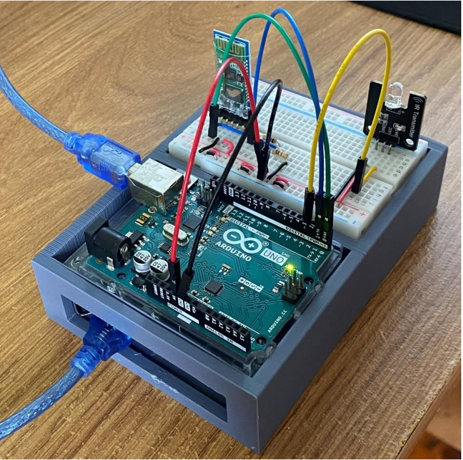
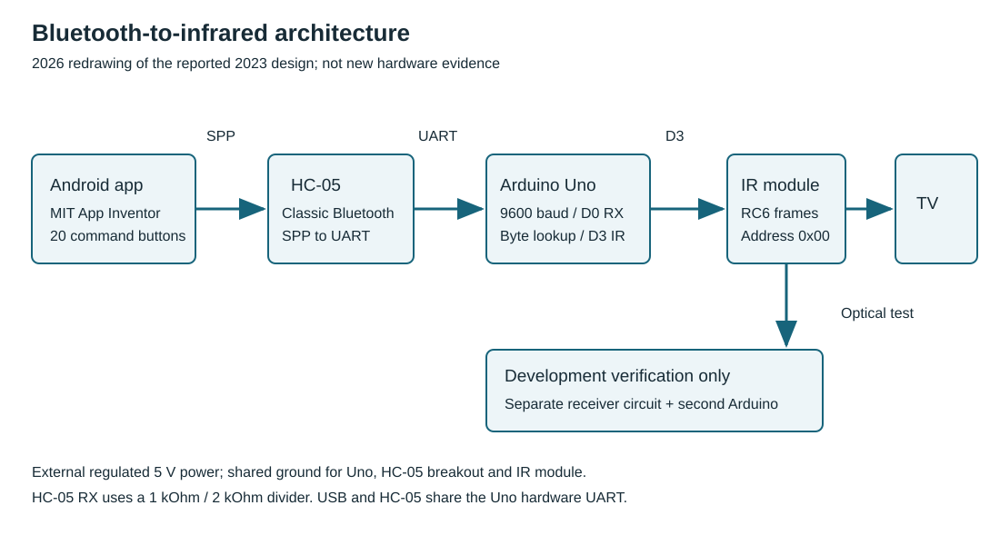

# Bluetooth-to-Infrared Remote Controller

**Android app · Arduino Uno · Bluetooth serial · Infrared communication · Embedded C++**

A wireless remote-control system developed for my final-year Electronic and Computer Engineering project at the University of Limerick (2023). An Android interface sends commands over Bluetooth to an Arduino, which translates them into infrared signals for a television. The prototype was developed through successive receiver, transmitter, LED, LED-strip and TV-control demonstrations.



## Project highlights

- **End-to-end hardware/software integration:** Android controls a Bluetooth-connected microcontroller driving an IR transmitter.
- **Protocol work:** Bluetooth serial commands are mapped to NEC2 commands during LED-strip development and RC6 commands for the television.
- **Incremental verification:** Independent IR transmitter and receiver circuits were used to inspect codes before full system integration.
- **Mechanical design:** A SolidWorks-designed enclosure was produced for the final prototype.
- **Reproducible software checks:** The modern command dispatcher passes 515 host-side checks in both standard and `NDEBUG` build configurations.

## System architecture



| Stage | Design |
| --- | --- |
| User input | Android application created with MIT App Inventor |
| Wireless link | HC-05 classic Bluetooth module using serial communication |
| Embedded controller | Arduino Uno (ATmega328P), 9600-baud serial input |
| Output | IR transmitter module connected to Arduino digital pin D3 |
| Target | Infrared-controlled television (RC6 command profile) |
| Verification | Separate Arduino/IR receiver circuit used during prototype development |

**Command path:** App button → one ASCII-compatible input byte → Bluetooth serial → Arduino command lookup → RC6 address/command → IR transmitter → TV receiver.

For example, selecting **Volume Up** sends the byte for `'1'` (decimal 49). The controller maps it to RC6 address `0x00`, command `0x10`. The [complete mapping](docs/commands.md) covers 20 buttons.

## Development and results

| Development stage | Demonstration |
| --- | --- |
| IR reception | Decode remote-control signals and print command information through the serial monitor |
| IR transmission | Send known codes to a separate receiver and operate an LED strip |
| Bluetooth communication | Control a test LED from an Android app through the HC-05 and Arduino |
| Integrated controller | Use Android app buttons to transmit infrared functions for the LED strip and television |
| Finished assembly | House the electronics in a custom 3D-printed enclosure |

Explore the [original prototype photographs and app screenshots](docs/evidence.md) and the [hardware wiring](docs/hardware.md).

## Firmware and tests in this repository

The `software/firmware` directory contains a **2026 reconstructed implementation** of the TV controller's command-dispatch behaviour, using a fixed lookup table and the modern IRremote library interface. It is separate from the 2023 prototype implementation; the reconstructed code and documentation were developed with AI assistance. The original project is represented here by its photographs, design diagrams, app screenshots and documented engineering results. See [project history](docs/project-history.md).

The host-side test program validates the mapping of all 256 possible input bytes, the 20 valid commands, ignored inputs and IR dispatch calls using test doubles.

From the project root, with Python 3 and a `g++` compiler:

```powershell
python software/tools/run_tests.py
```

**Verified result:** Both standard and `NDEBUG` builds compile successfully and pass **515 checks per build**, including a Windows run on 11 November 2026. These tests verify the reconstructed software logic, rather than physical IR output. Details are in [verification](docs/verification.md).

## Explore the repository

| Resource | Contents |
| --- | --- |
| [Hardware and wiring](docs/hardware.md) | Components, signal flow, connection details and safety notes |
| [Firmware implementation](docs/implementation.md) | Embedded software architecture and Android interface workflow |
| [IR command mappings](docs/commands.md) | Input bytes, functions and infrared commands |
| [Project evidence](docs/evidence.md) | Original prototype photographs, app screenshots and development milestones |
| [Build and run](docs/build-and-run.md) | Windows tests and Arduino target-build instructions |
| [Verification](docs/verification.md) | Software test results and the scope of demonstrated operation |
| [Project history](docs/project-history.md) | 2023 engineering work and 2026 software reconstruction |
| [Source code](software/firmware/BluetoothIrRemote/BluetoothIrRemote.ino) | Arduino firmware reconstruction |

## Further development

The natural next steps are compiling the reconstructed sketch against the actual Arduino AVR toolchain, deploying it on an Uno, and capturing RC6 output with an independent IR receiver. The historical prototype operated physical devices; the reconstructed firmware has been verified through host tests so far.

*Project: Matthew Coyle · Electronic and Computer Engineering, University of Limerick*
