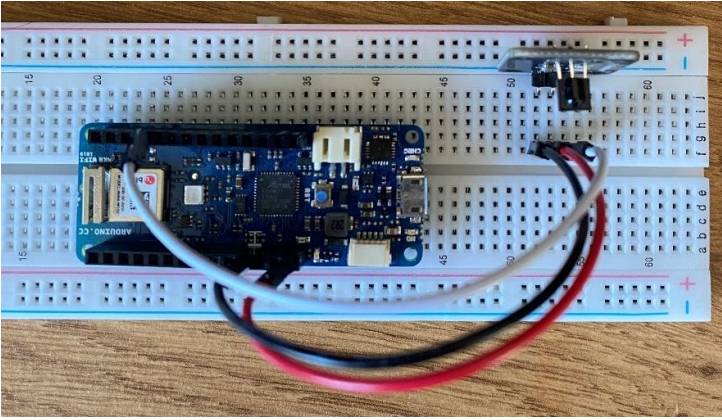
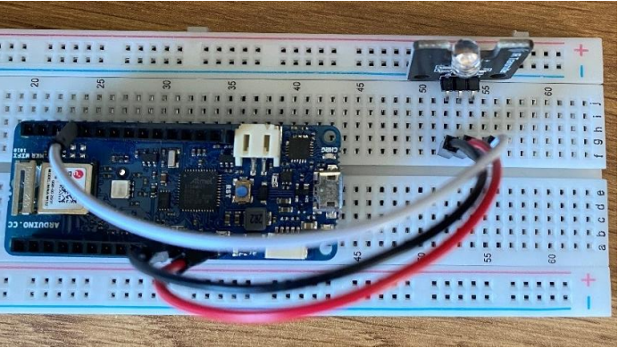
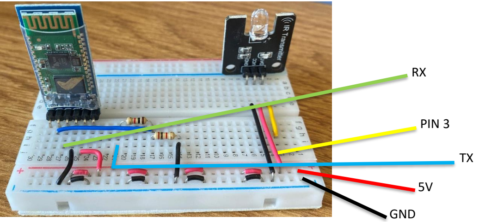
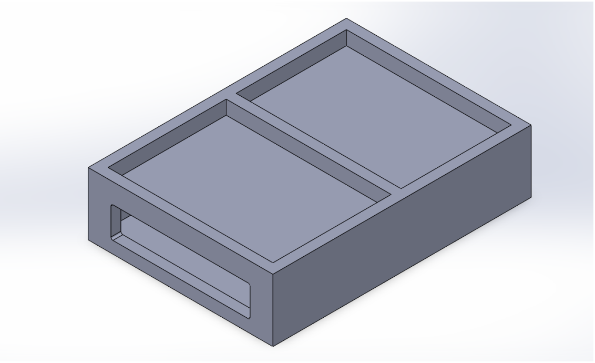
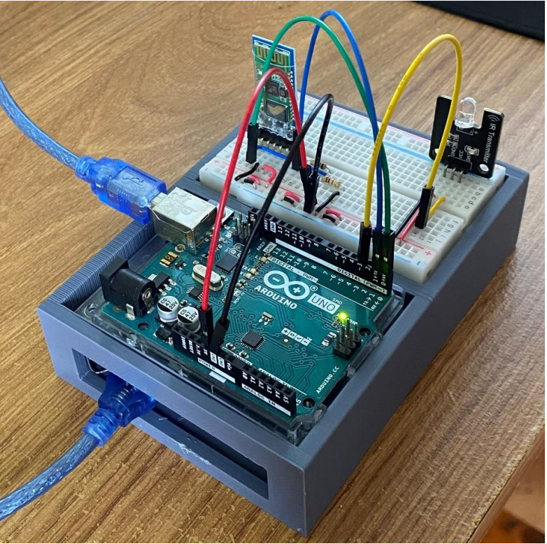
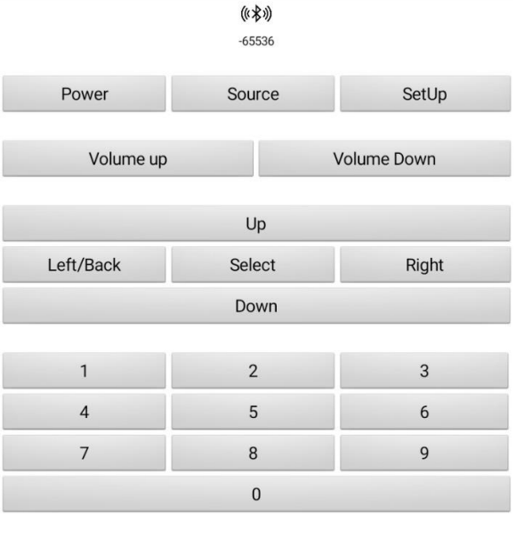
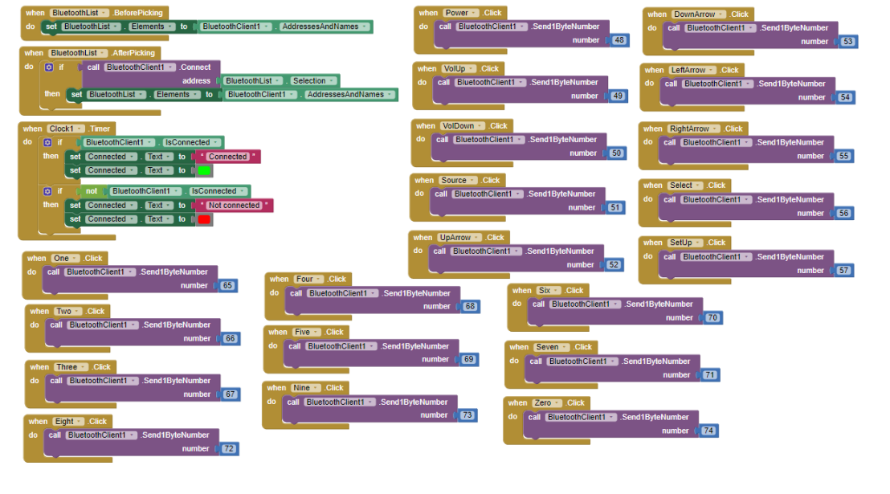

# Prototype development and results

The final-year project progressed from independent infrared tests to a working Android-controlled infrared transmitter and a finished enclosure. The images below are from the **2023 prototype**.

## Development milestones

| Stage | Engineering activity | Demonstrated result |
| --- | --- | --- |
| IR reception | Connected an IR receiver to a development board and inspected decoded data over serial | Captured command, address and protocol information from remotes |
| IR transmission | Built a second circuit to emit known codes and checked them on the receiver | Confirmed transmitter/receiver communication, then controlled an LED strip |
| Bluetooth integration | Connected an Android app to an HC-05 and a simple LED circuit | Toggled the LED using app commands |
| App-controlled IR | Combined Bluetooth input with infrared output | Operated LED-strip power, brightness and colours from the phone |
| Television control | Updated the app controls and switched to RC6 command mappings | Controlled television functions through the infrared transmitter |
| Packaging | Designed and 3D printed an enclosure | Integrated the controller, circuitry and power arrangement into a portable assembly |

## Hardware photographs

*Early receiver circuit for decoding infrared commands.*

*Separate transmitter circuit used to verify output codes.*

*Integrated Bluetooth and infrared transmitter development circuit.*

*SolidWorks housing design.*

*Finished assembly with Arduino, Bluetooth module, IR transmitter and printed housing.*

## Mobile application

*MIT App Inventor controller interface.*

*Block-based logic mapping user actions to outgoing serial bytes.*

## Reproducible software verification

The modern C++ command implementation can be independently checked without physical electronics. The [test suite](../software/tests/test_remote.cpp) checks every input byte, the full 20-command table and sender dispatch using host doubles. Results and scope are recorded in [verification](verification.md).

The physical prototype milestones above were completed in 2023; the separate host tests exercise the reconstructed software in 2026. Both form part of the project's development history.
