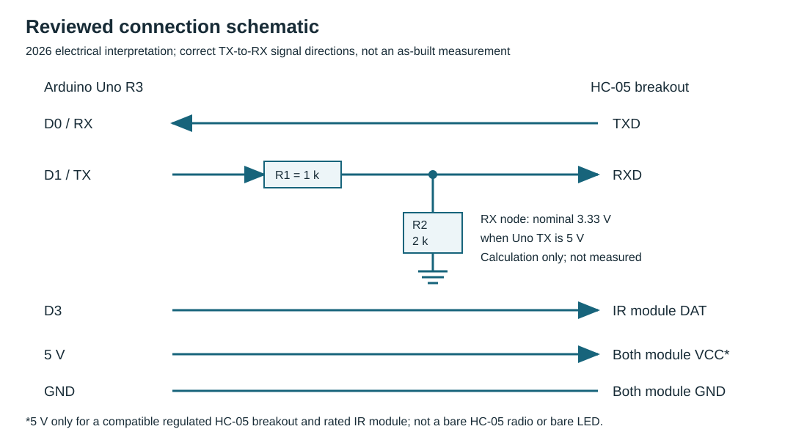
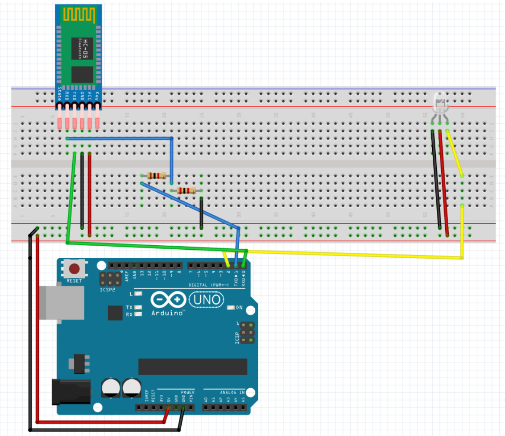
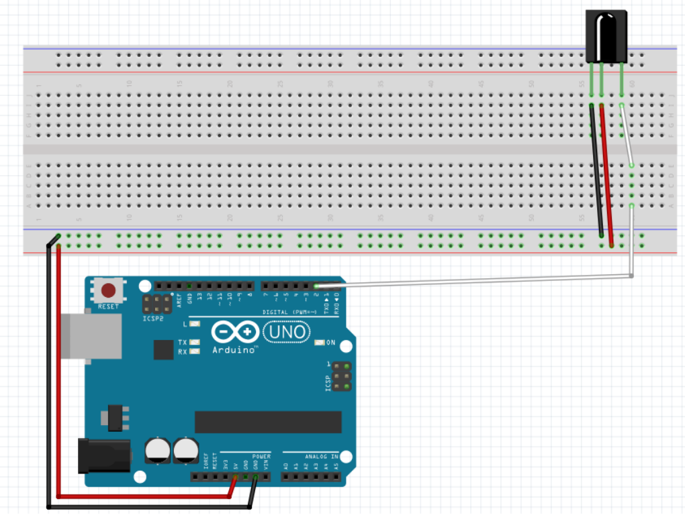
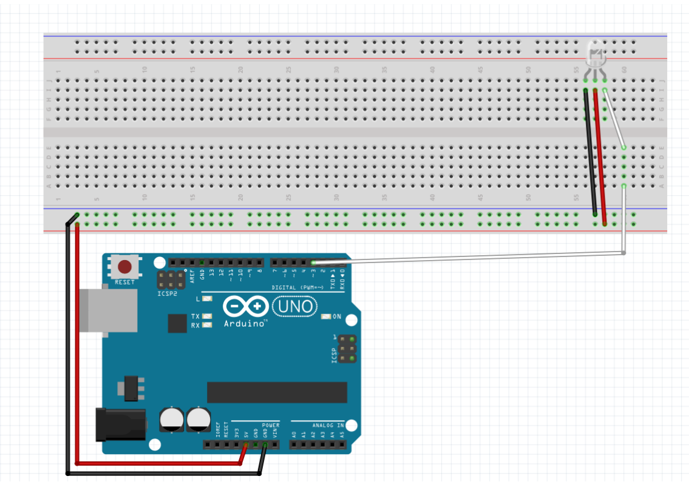
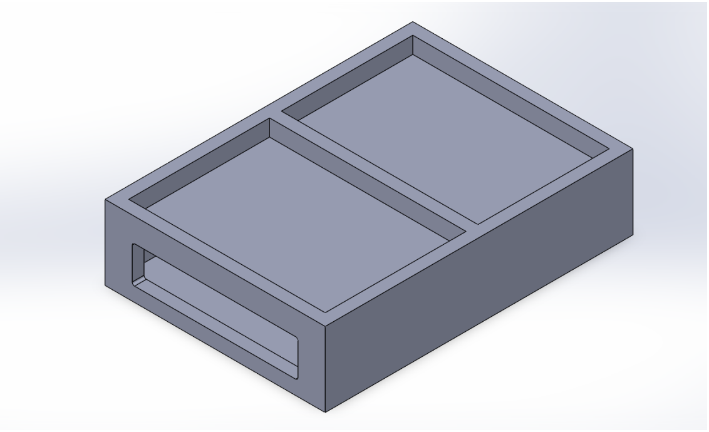

# Hardware architecture and wiring

The final prototype combined an Arduino Uno, HC-05 Bluetooth serial module and 38 kHz infrared transmitter. A separate receiver circuit and second controller were used during development to inspect infrared output before controlling the target devices.

## Core components

| Component | Function |
| --- | --- |
| Arduino Uno | Reads serial commands and selects IR output codes |
| HC-05 | Connects an Android device through classic Bluetooth serial communication |
| IR transmitter module | Sends modulated infrared signals towards the appliance receiver |
| IR receiver module | Decodes signals during development and verification |
| 1 kΩ / 2 kΩ resistors | Divide the Uno TX logic level for the Bluetooth module RX input |
| Regulated power supply | Powers the microcontroller and compatible module boards |
| Printed enclosure | Holds and positions the assembled controller |

## Wiring reference

| Arduino Uno | Connection | Role |
| --- | --- | --- |
| D0 / RX | HC-05 TXD | Incoming command bytes |
| D1 / TX | 1 kΩ to divider junction; 2 kΩ from junction to ground; junction to HC-05 RXD | Logic-level reduction for module RX |
| D3 | IR transmitter signal input | Infrared control output |
| 5 V | Compatible IR module and regulated HC-05 breakout VCC | Module power |
| GND | Module grounds and divider return | Common electrical reference |

The two resistors give a calculated divider output of approximately **3.33 V** from a 5 V high signal. Confirm the exact breakout's voltage rating and pin labels before reproducing the circuit; bare HC-05 radio modules and carrier boards have different power requirements. The published schematic is a reviewed design reference for reconstruction, not a fresh electrical test record.

**UART integration:** HC-05 TX connects to Uno RX. The Uno's USB interface shares hardware UART pins D0/D1, so disconnect the Bluetooth serial wiring during firmware upload and avoid simultaneous USB/Bluetooth transmitters on that UART.

## Original design views

*Original final-stage wiring illustration. Check physical pin labels rather than relying on drawing position.*

*Receiver test arrangement: signal output to digital pin D2.*

*Sender test arrangement: transmitter data input on digital pin D3.*

The project was developed through multiple controller configurations before settling on the Uno/HC-05 combination. Early test photographs show an MKR-family controller, whose 3.3 V logic requirements differ from those of the Uno.

## Enclosure

The housing was designed in SolidWorks and 3D printed to support the Uno, communications hardware, transmitter and portable power arrangement. The [finished prototype photograph](../assets/prototype-2023.png) shows the integrated assembly.

For a fresh hardware build, use a suitable regulated supply, check module current and voltage requirements, and validate the circuit before energizing it.
