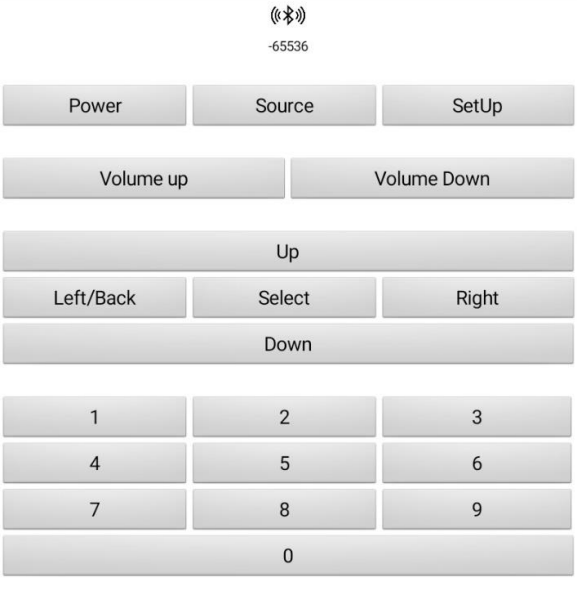
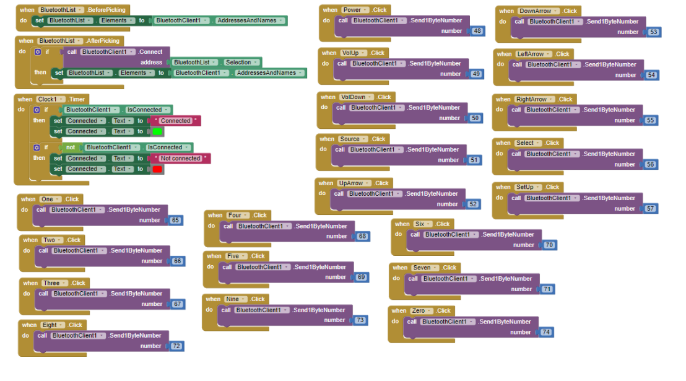

# Firmware and application design

## Serial-to-IR command flow

The Arduino receives a single input byte over serial at **9600 baud**. A valid byte selects an RC6 address and command, which is passed to the IRremote sender on D3.

```text
Bluetooth serial / USB serial
           |
     Serial.available()
           |
       Serial.read()
           |
       remote::lookup()
           |
      valid command? ---- no ---> ignore
           |
          yes
           |
 IrSender.sendRC6(address, command, 0)
           |
        delay(40)
```

The [Arduino sketch](../software/firmware/BluetoothIrRemote/BluetoothIrRemote.ino) performs setup, input reading and IR dispatch. The [command table](../software/firmware/BluetoothIrRemote/RemoteCommands.h) keeps the 20 mappings in one fixed-size array, making them easy to review and test without heap allocation.

The firmware has a deliberately simple single-byte protocol. Unexpected characters are ignored, and the sender requests a short 40 ms post-command delay. For an expanded system, a nonblocking input queue and reconnection handling would be useful enhancements.

## Infrared profiles

- **NEC2:** Used at an earlier development stage for LED-strip controls such as colour, brightness and power.
- **RC6:** Used by the final television command set, with address `0x00` and 20 mapped commands.

These are device-specific command profiles. The firmware in this repository implements the RC6 TV profile; the [command reference](commands.md) includes the earlier LED-strip mapping for engineering context.

## Android interface





The prototype used an Android application created in **MIT App Inventor**. A Bluetooth device picker established the HC-05 connection; each control button sent a byte representing a selected command.

A corresponding MIT App Inventor implementation can be recreated with these components and behaviours:

1. Add a `BluetoothClient`, a `ListPicker` to select paired Bluetooth devices, and buttons for the functions in the [command table](commands.md).
2. Populate the picker from `BluetoothClient.AddressesAndNames`, then call `BluetoothClient.Connect` using the chosen device.
3. On each button click, call `BluetoothClient.Send1ByteNumber` with the **decimal byte**, e.g. 48 for power (`'0'`) or 49 for volume up (`'1'`).
4. Display the connection status and disable control buttons when disconnected.
5. On modern Android releases, configure the Bluetooth permissions required by the installed App Inventor version.

The app screenshots document the original interface and block logic. An editable App Inventor project is not bundled here; the interface description and command table provide the basis for a new build.

## Why this architecture

The architecture deliberately separates **wireless input**, **embedded command translation** and **infrared output**. Each could be checked separately during development, while the fixed command table keeps the television protocol easy to extend to other appliances.
